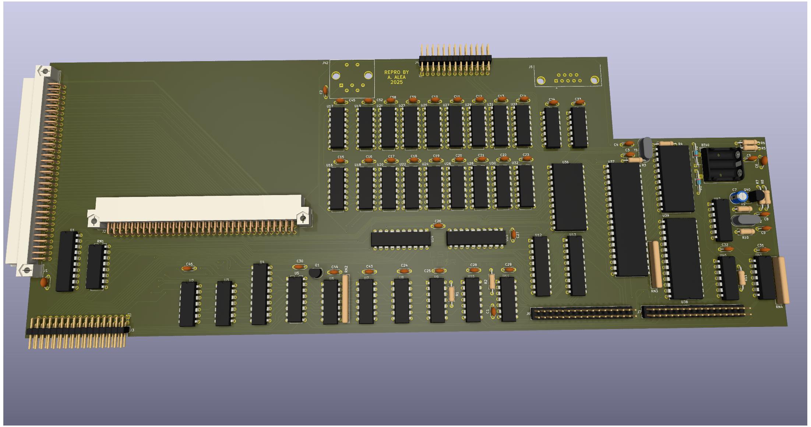

# CST Thor - Expansion board.

(C) 2023 Alvaro Alea Fernandez

License under: CERN Open Hardware Licence Version 2 - Strongly Reciprocal

https://ohwr.org/cern_ohl_s_v2.txt

This board has been reverse engineered from pictures freely available on internet.

THIS BOARD HAS NOT BEEN TESTED!! Use at your own risk.

The original GAL fuse maps (U4, U13) are unknown. Reconstructed equations,
derived from the schematic and from the Thor system ROM 5.22, are in
[doc/U4.pld](doc/U4.pld) and [doc/U13.pld](doc/U13.pld) and explained in
[doc/GAL_U4_U13.md](doc/GAL_U4_U13.md). They are not compiled or tested yet.
That document also lists schematic errors that must be fixed before the board
can work: the net of R1 / U13 pin 19 (floppy select), the swapped RAS/CAS net
names of U4, the DSMC pull-up of J2 and the VPA gate.

The SCSI interface and the WIN driver of the ROM are analysed in
[doc/SCSI.md](doc/SCSI.md).

## Information

This is the original expansion board of the Thor Computer.

* Get energy from a diferent power supply that QL (on backplane).
* Dimensions are not checked, there is mismatch in pictures.
* Schematic is not pretty, but is enought to be able to do the PCB.

